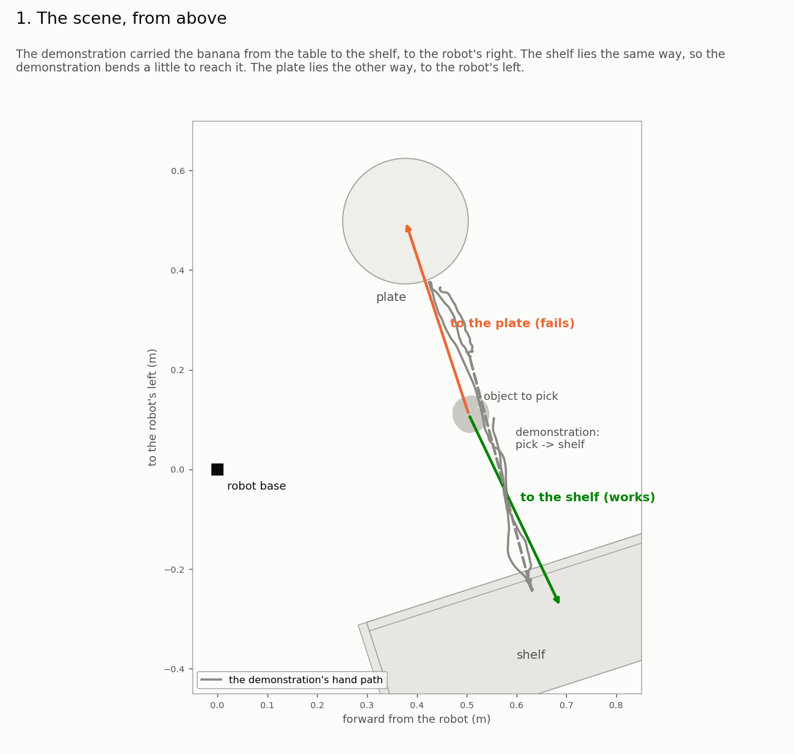
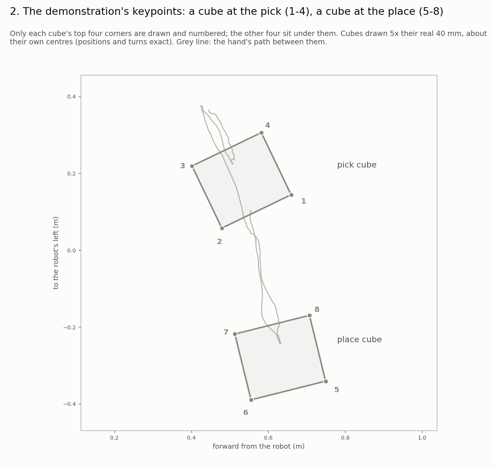
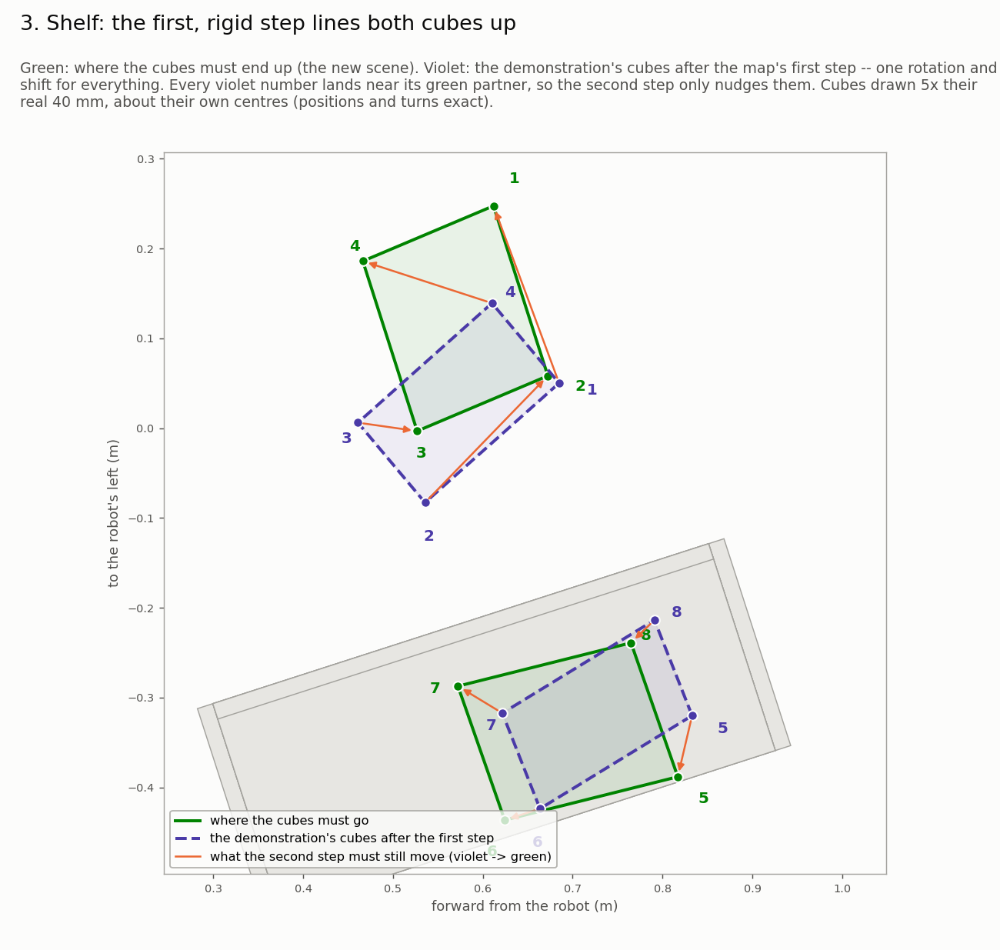
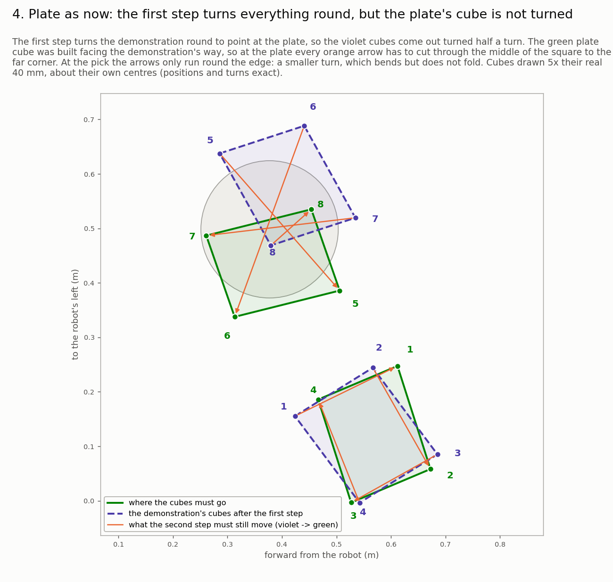
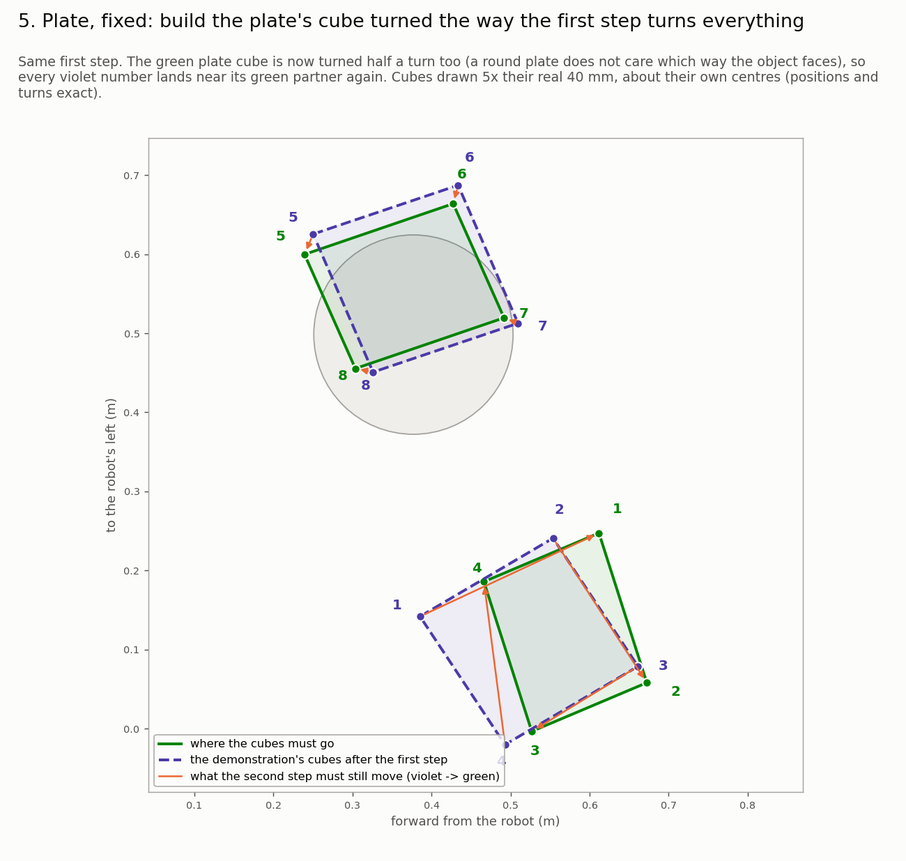
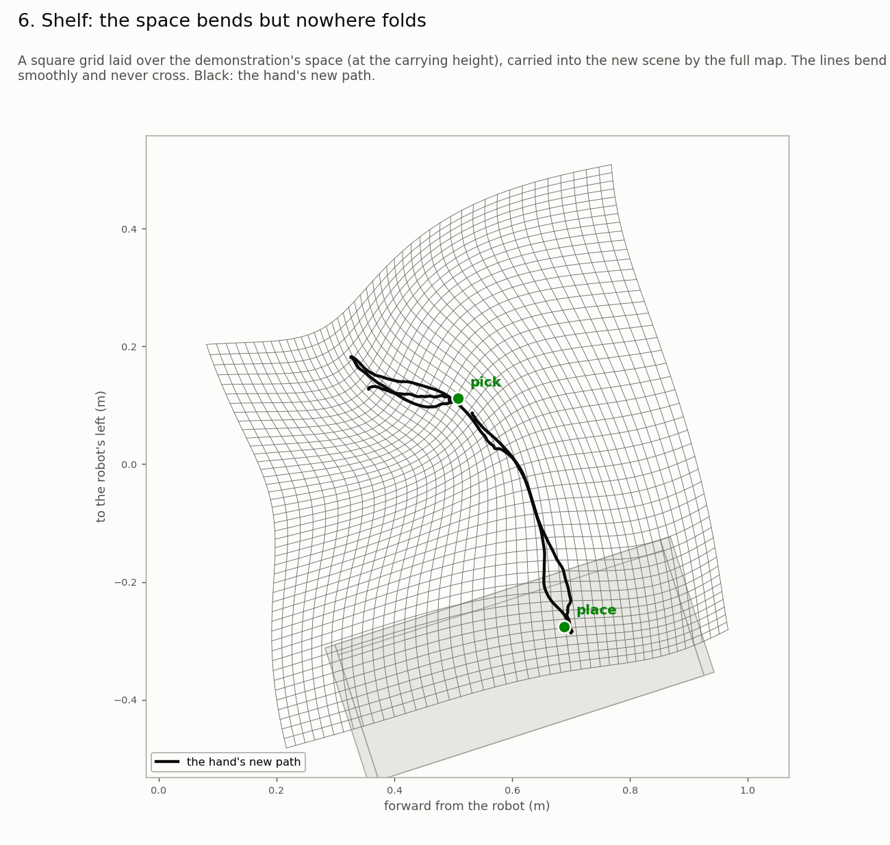
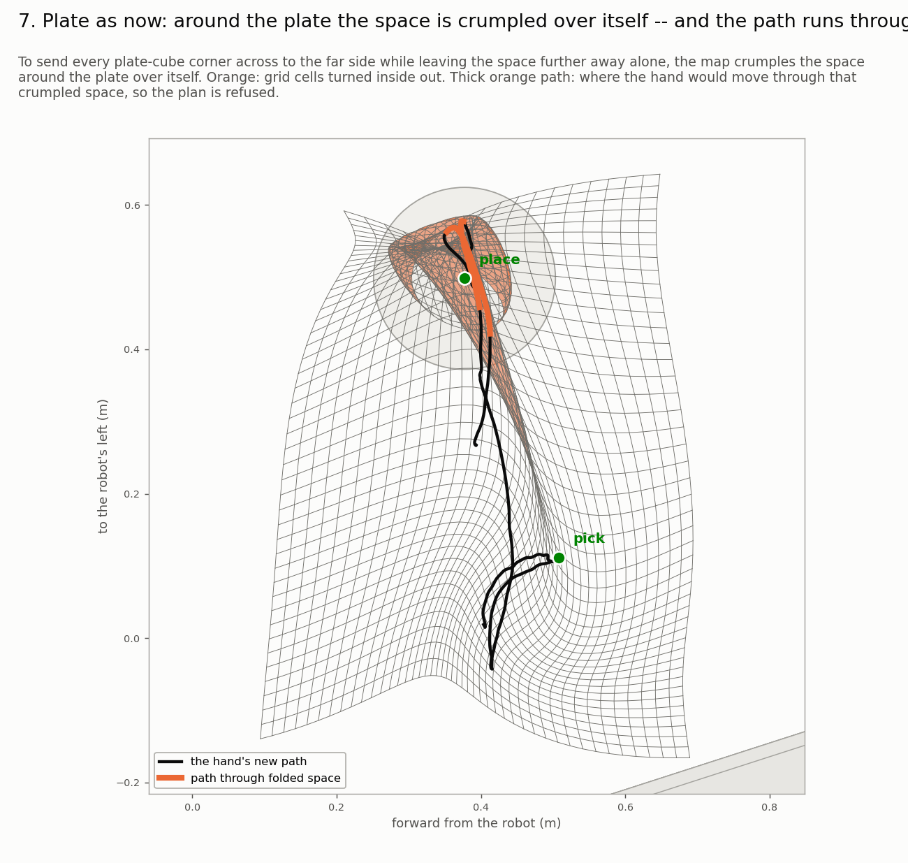
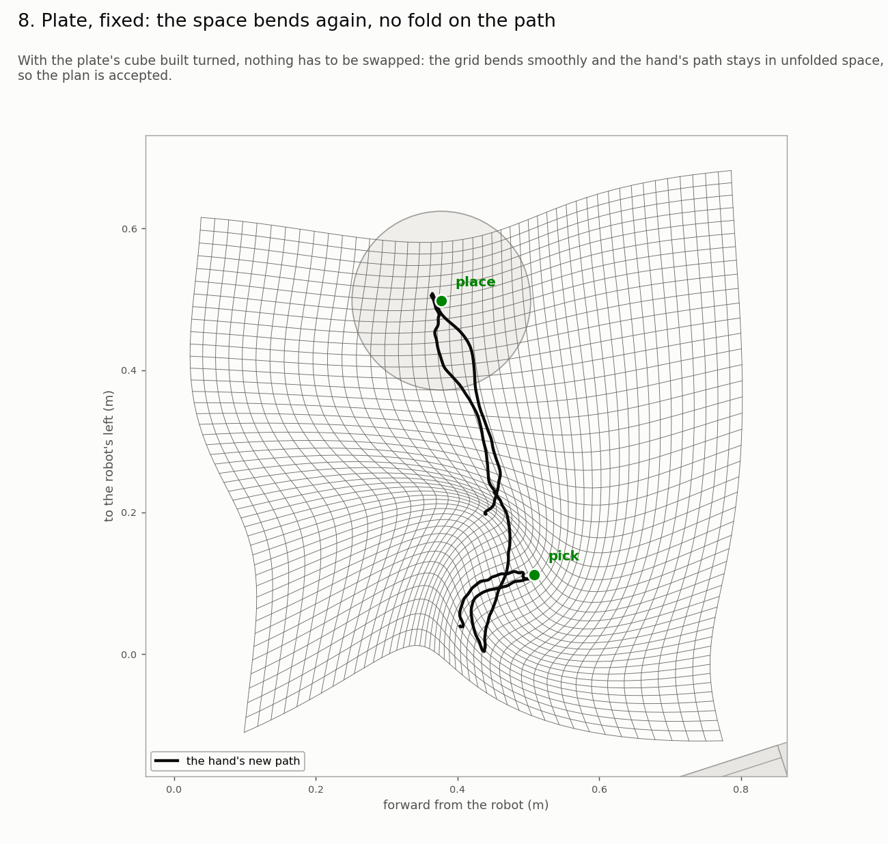
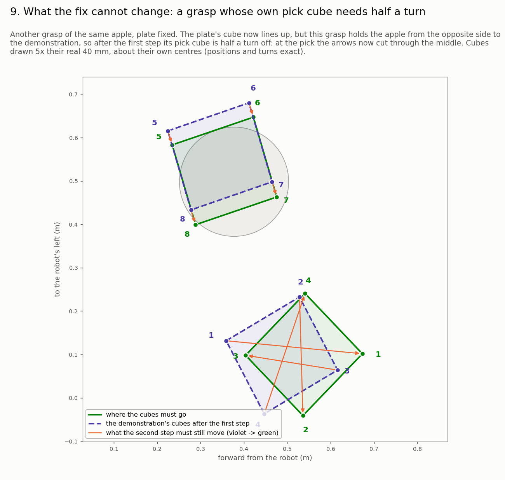
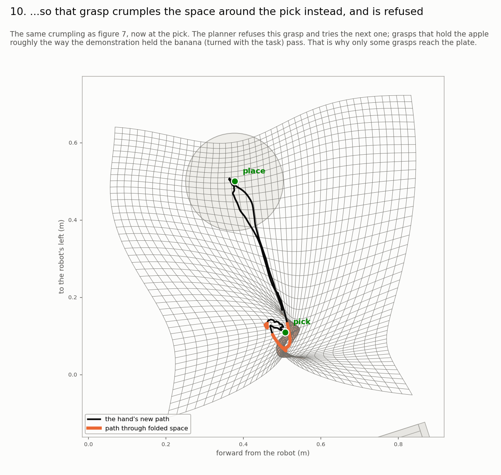

# Why the plate on the robot's left fails, and why turning its placed yaw fixes it

Ten pictures, one idea each, all from above. Regenerate with
`~/venvs/tpgpt/bin/python scripts/explain_plate_yaw.py` (an apple capture of 10-07, library grasps
#373 and #165, the 18:39 learned bundle; the "fixed" case turns the placed yaw inside the script
only). Colours throughout: grey = the demonstration, green = where things must go in the new scene,
violet = the demonstration after the map's first step, orange = what is still wrong / folded.

1. 
   The demonstration went from the table to the shelf, on the robot's right. The shelf is the same
   way; the plate is the opposite way.
2. 
   The demonstration's two keypoint cubes, corners numbered (pick 1-4, place 5-8), at their true
   positions and turns (drawn 5x larger).
3. 
   Shelf: the map's first step (one turn and shift of everything) already puts each violet number
   near its green partner.
4. 
   Plate as now: the first step turns everything round to face the plate, but the plate's green
   cube was built facing the demonstration's way -- every plate corner has to cross to the far side.
5. 
   The fix: build the plate's cube turned the same way. The numbers line up again.
6. 
   Graph paper carried through the whole map, shelf: it bends, nothing folds.
7. 
   Plate as now: crossing the corners over crumples the space around the plate over itself
   (orange), and the hand's path runs through it -- the plan is refused.
8. 
   Plate, fixed: the paper only bends; the plan is accepted.
9. 
   What the fix cannot change: a grasp holding the apple from the other side has its own pick cube
   half a turn off...
10. 
    ...so it crumples the space at the pick instead and is refused; the planner moves to the next
    grasp. This is why only some grasps reach the plate, as for the shelf.
